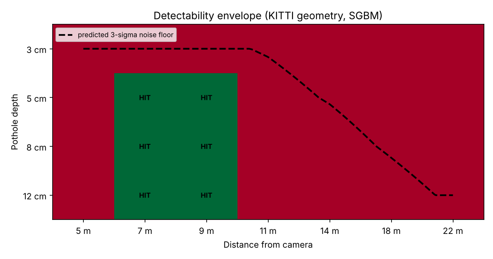

# Stereo-Vision Road Anomaly Detection

Metric pothole detection from a rectified stereo pair. Disparity → 3D point cloud →
RANSAC road plane → statistically significant depressions, reported in centimetres
and square metres rather than pixels.

The interesting part of this project is not the pipeline, which is standard. It is
the **error model**: stereo depth uncertainty grows as the square of range, and a
detector that ignores that is either blind up close or hallucinating at distance.
This one derives every threshold from the geometry, and reports the range beyond
which it refuses to answer.

---

## Headline result

For KITTI stereo geometry (f·B = 384 px·m, 1242×375), with SGBM disparity:

| | |
|---|---|
| Disparity accuracy vs ground truth | **0.168 px MAE**, 99.8% within 1 px |
| Camera height recovered | **1.651 m** (rendered: 1.650 m) |
| Road plane RMSE | **1.07 cm** over 88% inliers |
| Reliable detection range | **7–9 m** |
| End-to-end latency | **101 ms/frame** (CPU, 2 cores, 1242×375) |

The 7–9 m range is the honest finding, and the limits at both ends are physical,
not implementation defects:

- **Below 7 m** the road is outside the frame. At 1.65 m camera height, a point
  5 m ahead projects to image row 426 in a 375-row image.
- **Beyond ~10 m** a pothole is smaller than the noise floor. At 30 m, one pixel
  of disparity error is 2.34 m of depth error; a 5 cm pothole is 0.02 px of
  disparity, which no amount of post-processing recovers.

Measured signal-to-noise per pothole, synthetic scene:

| True depth | Range | Measured | σ(region) | SNR | Detected |
|---|---|---|---|---|---|
| 9.0 cm | 8.0 m | 7.6 cm | 0.20 cm | 7.60 | yes |
| 6.0 cm | 12.5 m | 3.3 cm | 0.90 cm | 0.66 | no |
| 4.5 cm | 17.0 m | 2.1 cm | 2.66 cm | 0.22 | no |
| 2.0 cm | 24.0 m | — | 8.83 cm | 0.15 | no |

The model's predicted cutoff (9.5 m) falls between the detected and undetected
cases. Prediction matches measurement.



---

## How it works

**1. Disparity — `src/disparity.py`**
Semi-Global Block Matching, with the search range derived from the closest depth
worth resolving rather than guessed: `num_disparities = ceil(f·B / Z_min / 16) · 16`.
Optional WLS filtering when `cv2.ximgproc` is present. Unmatched pixels are **NaN,
not 0** — zero is a legal disparity meaning "infinitely far", and conflating the
two puts phantom points at infinity in the cloud.

**2. Reprojection — `src/calibration.py`, `src/reconstruct.py`**
The Q matrix is built explicitly from the rectified intrinsics and signed baseline
rather than taken from `stereoRectify`, so the derivation is inspectable. KITTI's
baseline is recovered as `-P_rect_03[0,3] / fx`.

**3. Road plane — `src/road_plane.py`**
RANSAC written from first principles, with adaptive iteration count
(`log(1-p)/log(1-w³)`), near-collinear sample rejection, and an SVD total-least-
squares refit on the inlier set. The normal is forced to point up in camera frame
so that "below the road" is unambiguously negative. It raises rather than returning
a bad plane — a silently wrong plane puts a uniform false depression on the whole
road.

**4. Detection — `src/anomaly.py`**
Two-stage hypothesis test against `σ_Z = σ_d · Z²/(f·B)`:

- *Stage 1 (recall):* per-pixel candidates at a range-adaptive threshold, scaled
  for the median filter already applied.
- *Stage 2 (precision):* a region is accepted only if the mean depression of its
  **deeper half** exceeds `3σ_Z / √(N/8)`. Testing the deeper half rather than the
  whole blob decouples the result from stage 1's threshold — blob extent and blob
  median are otherwise coupled, and loosening stage 1 would drag the median up.
  The ÷8 is a spatial-correlation discount: SGBM errors are not independent across
  pixels, and treating them as independent overstates confidence roughly 3×.

Reported depth is the 2nd percentile (robust peak), not the minimum, which is the
single noisiest pixel in the region.

**Why this matters:** an earlier version used a fixed 2.5 cm threshold and returned
**25 detections on a 4-pothole scene**, every false positive beyond 28 m. The error
model removed all of them without losing the true positive.

---

## Quick start

```bash
pip install -r requirements.txt

python scripts/run_demo.py          # synthetic data with ground truth — no download
python -m pytest tests/ -q          # 12 geometry tests
python experiments/range_study.py   # detectability envelope + chart
```

On real KITTI data (`https://www.cvlibs.net/datasets/kitti/`, **synced+rectified**):

```bash
python scripts/run_kitti.py \
  --left  data/kitti/image_02/data/0000000000.png \
  --right data/kitti/image_03/data/0000000000.png \
  --calib data/kitti/calib_cam_to_cam.txt
```

The pipeline assumes rectified input and does not run `stereoRectify`. Unrectified
images produce a plausible-looking but meaningless disparity map.

---

## Synthetic data

`src/synth.py` renders both views by ray-casting the **same world surface** from two
camera centres separated by the real baseline, so disparity is correct by
construction rather than faked with a pixel shift. A unit test asserts the rendered
pair satisfies `d = f·B/Z` to 1e-5 relative — without that, every accuracy number
measured against it would be meaningless.

This is a development harness. Numbers reported anywhere public must come from real
stereo data.

---

## SGBM smoothness study

SGBM's P1/P2 penalties suppress small depressions along with noise. Measured peak
depth recovered per configuration:

| Config | 8 m (true 9 cm) | 12.5 m (true 6 cm) | 17 m (true 4.5 cm) | Coverage |
|---|---|---|---|---|
| P1/P2 = 8/32 (default) | 9.8 cm | 4.7 cm | 6.1 cm | 0.393 |
| P1/P2 = 2/8 | 11.3 cm | 7.8 cm | 7.3 cm | 0.346 |
| P1/P2 = 2/8, block 3 | 12.4 cm | 7.7 cm | 7.5 cm | 0.327 |
| P1/P2 = 1/4, block 3 | 12.5 cm | 6.8 cm | **26.7 cm** | 0.297 |

Softening the penalties recovers ~3 cm more true depth at 12.5 m but inflates
far-field noise 4–6× — the last row reports 26.7 cm for a 4.5 cm pothole, which is
pure noise — and costs 10% of matched pixels. The default is kept.

---

## Limitations

Stated plainly, because a detector whose failure modes are undocumented cannot be
trusted on a vehicle:

- **Range is 7–9 m** with this geometry. A longer baseline or higher resolution
  moves it out; post-processing does not.
- **The road-plane prior assumes a locally flat surface.** Crests, dips and banked
  curves violate it. A piecewise or quadratic surface model is the fix.
- **The ROI is a fixed geometric prior** (lower-centre of the frame), not a
  segmentation. It will mis-fire where the road is not where the prior expects.
- **`disp_sigma_px = 0.25` is measured on synthetic data.** Re-measure on real
  stereo before trusting any threshold; everything downstream scales with it.
- **No temporal filtering.** Each frame is independent; tracking across frames
  would cut false positives substantially.
- **Validated on synthetic data only.** Real-world validation is pending.

---

## Next steps

- **Learned stereo** (RAFT-Stereo, CREStereo) in place of SGBM. The smoothness
  study above shows the ceiling is set by the matcher's prior, not the detector.
- **TensorRT INT8 on Jetson Orin.** `src/bench.py` provides the ONNX Runtime path
  and the measurement harness; `scripts/export_onnx.py` does the export. CPU ONNX
  numbers do **not** predict Jetson throughput — different memory bandwidth,
  different kernels — and are not presented as if they do.
- **Temporal fusion** across frames to suppress single-frame false positives.
- **Appearance-based detector** fused with the geometric one, to cover wet or
  textureless road where stereo has no disparity at all.

---

## Layout

```
src/calibration.py    intrinsics, baseline, Q matrix, error model
src/disparity.py      SGBM + WLS, parameter derivation
src/reconstruct.py    disparity -> metric point cloud, road ROI, PLY export
src/road_plane.py     RANSAC plane fit from first principles
src/anomaly.py        two-stage significance test, metric detections
src/pipeline.py       orchestration + timings
src/synth.py          physically consistent synthetic stereo
src/bench.py          latency harness + ONNX inference path
scripts/run_demo.py   synthetic end-to-end with ground-truth comparison
scripts/run_kitti.py  real KITTI data
experiments/          detectability envelope study
tests/                12 geometry tests
```
